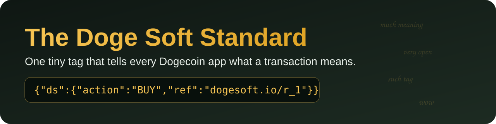

<p align="center">
  
</p>

<h1 align="center">The Doge Soft Standard (<code>ds</code>)</h1>

<p align="center">
  <b>One tiny tag that tells every Dogecoin app what a transaction means.</b><br>
  Much meaning. Very open. Wow.
</p>

<p align="center">
  <a href="SPEC.md">Spec</a> ·
  <a href="https://docs.dogesoft.io/inscription-standard/">Docs</a> ·
  <a href="https://explorer.dogesoft.io">Explorer</a> ·
  <a href="https://dogesoft.io">dogesoft.io</a> ·
  <a href="https://x.com/dogesoftio">@dogesoftio</a>
</p>

<p align="center">
  <a href="https://github.com/builderdogecoin/ds-standard/actions/workflows/ci.yml"></a>
  
  
  
  
</p>

---

## Wow. Such tag. Very small.

A Dogecoin transaction moves coins and Doginals. It doesn't say *why*. Was that a sale? An accepted offer? A tip on a post? A bridge deposit? A council vote?

The Doge Soft Standard answers that with one tag:

```json
{"ds":{"action":"<VERB>","ref":"<Doge Soft-issued id>"}}
```

That's the whole tag.

- `action` is an **UPPERCASE** verb from the [registry](#the-verbs).
- `ref` names the signed record behind it: `<domain>/<local>`, with `dogesoft.io` as the default domain.
- **Nothing else sits inside `ds`.** Price, seller and buyer are already in the transaction outputs.

Any app, wallet, explorer or marketplace can read it, write it and check it. The `ds` tag is Doge Soft's. The Doginals and DRC-20 protocols are not: Doge Soft follows their rules strictly and adds nothing to them. A `ds` tag rides *beside* those protocols and never changes what they mean.

## A quick example

A Doginal sells. The sale transaction carries one extra output, a 0-value `OP_RETURN` note:

```text
OP_RETURN  {"ds":{"action":"BUY","ref":"dogesoft.io/r_6"}}
```

That's a real one: transaction [`04d3e5ff…6aaa`](https://explorer.dogesoft.io/tx/04d3e5ffba0fe45f8080f04914ebd17a093a58445e6b3ce773f129712d506aaa) at block 6,454,390. The ref `dogesoft.io/r_6` resolves to a record signed by Doge Soft, and any Dogecoin wallet can check that signature. Standard inscription parsers ignore the note, so every Doginals wallet and explorer still sees a normal transfer.

On a DRC-20 transfer the tag sits right in the inscription body:

```json
{"p":"drc-20","op":"transfer","tick":"DU$T","amt":"1000","ds":{"action":"BUY","ref":"dogesoft.io/r_1"}}
```

## The verbs

29 verbs in 6 areas. The machine-readable list is [`schema/verbs.json`](schema/verbs.json).

| Area | Verbs | Where it rides |
|---|---|---|
| 🛒 [Marketplace](docs/verbs/marketplace.md) | `BUY` `AUCTION_SOLD` `OFFER_ACCEPT` `GIFT` `BUNDLE` `PARTIAL_FILL` `COLLECTION_TRANSFER` | One `OP_RETURN` note on the transaction that spends the dog |
| 💬 [Social](docs/verbs/social.md) | `TIP` `REVEAL` `BOOST` | The payment for a post or profile |
| 🚀 [Launchpad](docs/verbs/launchpad.md) | `LAUNCH_DEPLOY` `LAUNCH_MINT` | The collection record, and the buyer's mint transaction |
| 🏛️ [Governance](docs/verbs/governance.md) | `GOV_CREATE` `GOV_UPDATE` `GOV_PROPOSE` `GOV_VOTE` `GOV_FINALIZE` `GOV_EXECUTE` `GOV_CANCEL` `GOV_DELEGATE` `GOV_APPOINT` `GOV_REMOVE` `GOV_RESIGN` `GOV_TRANSFER_AUTHORITY` | The inscription is the decision |
| 🛡️ [Security](docs/verbs/security.md) | `ANCHOR` `REFUND` | Proof anchors and refunds from Doge Soft services |
| 🌉 [Bridge](docs/verbs/bridge.md) | `BRIDGE_L1_DEPOSIT` `BRIDGE_L1_RELEASE` `BRIDGE_L2_INTENT` | Soft Bridge inscriptions, created only by Doge Soft services |

**Listings, offers, bids and cancels are signed records, not inscriptions.** They never get a tag. A tag goes on chain only when something actually moves.

## Where it rides

| Shape | Used by | Rule |
|---|---|---|
| `OP_RETURN` note | Marketplace trades, DOGE social payments | One push of the UTF-8 JSON `{"ds":{...}}`, **at most 80 bytes**, **one per transaction**. In a trade it goes after the seller's payment output. |
| `ds` field in an inscription body | DRC-20 transfers, `LAUNCH_DEPLOY`, governance, bridge | `ds` sits beside the protocol's own fields and holds only `action` and `ref`. |

The note push is one length byte, or `0x4c` and a length byte from 76 bytes up. A post id of up to 33 characters fits all three social verbs; at 33 characters a `REVEAL` note is exactly 80 bytes. The test vectors check that boundary.

## Who signs what (trades)

| Who | Sighash | Why |
|---|---|---|
| Seller | `SIGHASH_SINGLE\|ANYONECANPAY` (`0x83`) on their payment output | Locks "this dog for this amount, paid to me" and nothing else |
| Buyer, bidder or offer signer | `SIGHASH_ALL` (`0x01`) | Commits to every output, so the tag is already in the template before they sign |

The tag adds meaning and traceability. The signatures and Dogecoin's own transaction rules are what secure the trade.

## Verify a record yourself

Every ref names a record. The signature is a standard Dogecoin `signmessage` over:

```text
Doge Soft
<the JSON of the record>
```

That's the text `Doge Soft`, a newline, then the record JSON exactly as served. Fetch one and check it, no Doge Soft code needed:

```bash
curl -s https://marketplace.dogesoft.io/ds/ref/r_6
# { "record": {...}, "signer": "D9m4ufeHBjLSR8tStQopLs8BQBVoDzbQtw", "sig": "ID4D...", "message_prefix": "Doge Soft\n", ... }
```

Paste `signer`, `sig` and the message into any Dogecoin wallet's *verify message*, or use the reference verifier:

```bash
curl -s https://marketplace.dogesoft.io/ds/ref/r_6 | node bin/ds.js verify -
# { "ok": true, "prefix": "Doge Soft\n", "legacy": false }
```

Older inscribed records may still verify under the previous prefixes `Doge Soft ref record` and `Doge Soft collection record`. The verifier tries those too.

## The reference parser

[`src/`](src/) is a tiny parser and validator in plain JavaScript. **Zero dependencies**, Node.js 18 or newer, built-ins only. It even carries its own RIPEMD-160 and secp256k1 recovery, so verifying a signature needs nothing but Node.

```js
import { validateNoteText, decodeNote, encodeNote, inspectTrade, verifyRecord } from './src/index.js';

validateNoteText('{"ds":{"action":"BUY","ref":"dogesoft.io/r_1"}}');   // { ok: true, action: 'BUY', area: 'Marketplace', ... }
validateNoteText('{"ds":{"action":"buy","ref":"dogesoft.io/r_1"}}');   // { ok: false, errors: ['action_not_uppercase'] }
encodeNote('BUY', 'dogesoft.io/r_1').scriptHex;                         // '6a2f7b226473223a...'
inspectTrade(rawTxHex);                                                 // note, sighash per input, and every trade check
verifyRecord(await (await fetch('https://marketplace.dogesoft.io/ds/ref/r_6')).json());
```

Or from the command line:

```bash
node bin/ds.js check '{"ds":{"action":"BUY","ref":"dogesoft.io/r_1"}}'
node bin/ds.js note BUY dogesoft.io/r_1
node bin/ds.js decode 6a2f7b226473223a7b22616374696f6e223a22425559222c22726566223a22646f6765736f66742e696f2f725f36227d7d
node bin/ds.js verbs
```

## Test vectors

[`vectors/`](vectors/) holds the cases every implementation should agree on, in plain JSON (CC0, use them for anything):

| File | What it checks |
|---|---|
| `tags.json` | Valid and invalid tags: lowercase actions, extra fields inside `ds`, bad ref formats, social and bridge ref rules |
| `op-return.json` | Note scripts at 75, 76, 79, 80 and 81 bytes, push forms, trailing bytes, UTF-8 |
| `transactions.json` | Two real mainnet trades: the note, its output, and the `0x83` / `0x01` sighashes |
| `records.json` | Live signed records, plus tampered, reordered and wrong-signer copies |
| `launch-deploy.json` | Collection record shapes and royalty rules |
| `governance-tally.json` | Quorum and approval edge cases |

```bash
npm test     # runs every vector, no install step
```

## Build on it

Anyone can run a marketplace, a social app or a wallet on these verbs. Start with [docs/building.md](docs/building.md), then read the normative [SPEC.md](SPEC.md). Want a new verb? Write a [Such Verb Proposal](proposals/README.md). 🐕

## What's in here

| Path | What it is |
|---|---|
| [`SPEC.md`](SPEC.md) | The normative standard (MUST / SHOULD) |
| [`docs/`](docs/) | Friendly guides: each verb area, signed records, building on ds, FAQ |
| [`schema/`](schema/) | JSON Schemas for the tag, the note, signed records and `LAUNCH_DEPLOY`, plus the verb registry |
| [`vectors/`](vectors/) | Test vectors |
| [`src/`](src/), [`bin/`](bin/) | The zero-dependency reference parser and the `ds` command |
| [`proposals/`](proposals/) | Such Verb Proposals: how new verbs join the registry |

## Not part of this standard

- **Dogecoin Names** keeps its own signed format (`"p":"dns"` with a registrar `sig`). See [Names & registrars](https://docs.dogesoft.io/names/registrar/).
- **DRC-20** deploy, mint and transfer are their own protocol. They stay positional, so every DRC-20 wallet reads them.
- **Posts, likes, follows and messages** move nothing, so they stay with the app.

## Join the Orbit

- Found a parser that disagrees with a vector? Open an issue. We love a good DIFF.
- Want to help? See [CONTRIBUTING.md](CONTRIBUTING.md).
- Security issue? Follow [SECURITY.md](SECURITY.md) and don't open a public issue.
- **Never share your seed phrase** with anyone, including anyone who says they're from Doge Soft. Much safe, very self-custody.

## License

Code is Apache-2.0, the spec and docs are CC-BY-4.0, test vectors and schemas are CC0. Details in [LICENSING.md](LICENSING.md). "Doge Soft" and its logos are not licensed for use as your own brand.

<p align="center"><i>Much meaning. Very open. Such love. — the Doge Soft Orbit</i></p>
